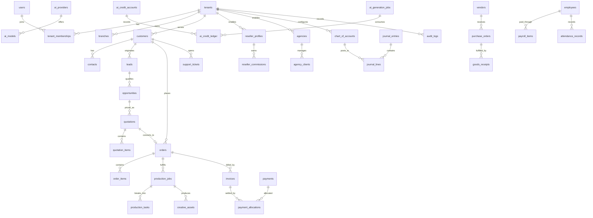

# 02 — ERD and Physical Data Dictionary (Initial Draft)

**Version:** 0.1 Draft | **Target:** PostgreSQL 18  
This is a proposed physical model, not an applied migration. Naming uses `snake_case`, UUID primary keys, `timestamptz` UTC timestamps, `numeric(18,2)` money, and `numeric(18,6)` rates/quantities where needed.

## 1. Modeling rules
- Every tenant-owned table includes `tenant_id uuid NOT NULL` and an index beginning with `tenant_id`.
- Global reference tables are explicitly marked global; tenant-owned data never relies on globally unique human numbers alone.
- PK: `id uuid`; audit timestamps: `created_at`, `updated_at`; actor columns: `created_by`, `updated_by` where applicable.
- Soft deletion is `archived_at`/`deleted_at` only where retention rules permit; financial ledgers are never deleted.
- Business document numbers are unique on `(tenant_id, document_type, document_no)`.
- Use FK constraints, check constraints, unique constraints, and partial indexes for active records.
- RLS is defense-in-depth; application services must still authorize every request.
- Use `jsonb` only for provider payload snapshots/configurable metadata, not as a substitute for relational core fields.

## 2. Logical ERD (domain relationships)

## 3. Core physical table inventory

### A. Platform, identity, organization
| Table | Purpose | Key columns |
|---|---|---|
| `tenants` | Tenant/company workspace | `id`, `slug`, `name`, `status`, `default_currency`, `timezone` |
| `tenant_settings` | Tenant configuration | `tenant_id`, `setting_key`, `setting_json` |
| `users` | Global identity profile (provider-linked) | `id`, `auth_subject`, `email`, `display_name`, `status` |
| `tenant_memberships` | User-to-tenant membership | `tenant_id`, `user_id`, `status`, `joined_at` |
| `roles` | Tenant/platform role definitions | `tenant_id`, `code`, `name`, `is_system` |
| `permissions` | Permission registry | `code`, `module`, `action`, `description` |
| `role_permissions` | Role-permission grants | `tenant_id`, `role_id`, `permission_id`, `scope_policy` |
| `membership_roles` | Roles assigned to memberships | `tenant_id`, `membership_id`, `role_id`, `branch_id`, `department_id` |
| `branches` | Operating branches | `tenant_id`, `code`, `name`, `status` |
| `departments` | Departments/teams | `tenant_id`, `branch_id`, `parent_id`, `name` |
| `fiscal_periods` | Financial periods | `tenant_id`, `starts_on`, `ends_on`, `status` |
| `number_sequences` | Document numbering | `tenant_id`, `document_type`, `prefix`, `next_value`, `period_id` |

### B. Website, catalog, CRM, sales
| Table | Purpose | Key columns |
|---|---|---|
| `cms_pages` | CMS pages | `tenant_id`, `slug`, `title`, `status`, `published_at` |
| `cms_revisions` | Page revision history | `tenant_id`, `page_id`, `revision_no`, `content_json`, `created_by` |
| `media_assets` | Uploaded/generated assets | `tenant_id`, `storage_key`, `mime_type`, `size_bytes`, `visibility` |
| `seo_metadata` | Page SEO metadata | `tenant_id`, `page_id`, `seo_title`, `description`, `canonical_url` |
| `service_categories` | Catalog taxonomy | `tenant_id`, `parent_id`, `name`, `sort_order` |
| `services` | Product/service master | `tenant_id`, `sku`, `name`, `service_type`, `status` |
| `service_versions` | Versioned service spec | `tenant_id`, `service_id`, `version_no`, `spec_json`, `effective_from` |
| `price_lists` | Retail/reseller/agency pricing | `tenant_id`, `code`, `channel`, `currency`, `valid_from`, `valid_to` |
| `service_prices` | Price per service/version | `tenant_id`, `price_list_id`, `service_version_id`, `unit_price` |
| `cost_rules` | HPP rule version | `tenant_id`, `service_version_id`, `credit_cost`, `labor_cost`, `overhead_cost` |
| `customers` | Customer/company directory | `tenant_id`, `customer_type`, `display_name`, `status`, `owner_user_id` |
| `customer_contacts` | Customer contact points | `tenant_id`, `customer_id`, `name`, `email`, `phone`, `is_primary` |
| `leads` | Prospects | `tenant_id`, `source`, `stage`, `owner_user_id`, `customer_id` |
| `opportunities` | Sales opportunities | `tenant_id`, `lead_id`, `value_amount`, `probability`, `stage` |
| `activities` | CRM timeline | `tenant_id`, `subject_type`, `subject_id`, `activity_type`, `due_at` |
| `quotations` | Quote header | `tenant_id`, `quote_no`, `customer_id`, `status`, `valid_until`, `total_amount` |
| `quotation_items` | Quote lines | `tenant_id`, `quotation_id`, `service_version_id`, `description_snapshot`, `qty`, `unit_price` |

### C. Orders, production, AI, portal, partners
| Table | Purpose | Key columns |
|---|---|---|
| `orders` | Order header | `tenant_id`, `order_no`, `customer_id`, `quotation_id`, `status`, `currency`, `total_amount` |
| `order_items` | Immutable order line snapshots | `tenant_id`, `order_id`, `service_version_id`, `description_snapshot`, `qty`, `unit_price`, `hpp_snapshot` |
| `order_briefs` | Creative brief | `tenant_id`, `order_id`, `brief_json`, `submitted_at`, `approved_at` |
| `subscriptions` | Recurring customer plan | `tenant_id`, `customer_id`, `plan_id`, `status`, `current_period_start`, `current_period_end` |
| `subscription_events` | Subscription lifecycle events | `tenant_id`, `subscription_id`, `event_type`, `effective_at`, `payload` |
| `production_jobs` | Fulfillment job | `tenant_id`, `order_id`, `job_no`, `status`, `priority`, `due_at` |
| `production_tasks` | Work tasks | `tenant_id`, `job_id`, `parent_task_id`, `assignee_user_id`, `status`, `due_at` |
| `creative_assets` | Output/input asset relation | `tenant_id`, `job_id`, `media_asset_id`, `asset_role`, `version_no`, `approval_status` |
| `quality_reviews` | QC checks | `tenant_id`, `job_id`, `reviewer_user_id`, `result`, `checklist_json` |
| `revision_requests` | Customer/internal revision | `tenant_id`, `job_id`, `requested_by`, `reason`, `status` |
| `ai_providers` | Provider registry | `code`, `name`, `integration_status` |
| `ai_models` | Model registry | `provider_id`, `code`, `capabilities_json`, `status` |
| `ai_provider_subscriptions` | Provider plan/invoice period | `tenant_id`, `provider_id`, `period_start`, `period_end`, `fee_amount`, `currency` |
| `ai_credit_accounts` | Credit pool | `tenant_id`, `provider_id`, `account_code`, `period_start`, `period_end` |
| `ai_credit_ledger` | Append-only credit movements | `tenant_id`, `account_id`, `entry_type`, `credits_delta`, `job_id`, `source_ref` |
| `ai_generation_jobs` | Generation requests | `tenant_id`, `provider_id`, `model_id`, `order_id`, `status`, `credits_estimated`, `credits_actual` |
| `reseller_profiles` | Reseller account | `tenant_id`, `customer_id`, `tier`, `status`, `agreement_id` |
| `reseller_commissions` | Commission accrual/reversal | `tenant_id`, `reseller_id`, `order_id`, `basis_amount`, `rate`, `amount`, `status` |
| `agencies` | Agency account | `tenant_id`, `name`, `status`, `billing_mode` |
| `agency_clients` | Agency-to-client access | `tenant_id`, `agency_id`, `customer_id`, `status` |
| `agency_members` | Agency user membership | `tenant_id`, `agency_id`, `user_id`, `role_code` |

### D. Billing, procurement, accounting, HR, support, governance
| Table | Purpose | Key columns |
|---|---|---|
| `invoices` | Invoice header | `tenant_id`, `invoice_no`, `customer_id`, `order_id`, `status`, `currency`, `total_amount` |
| `invoice_lines` | Invoice lines | `tenant_id`, `invoice_id`, `description`, `qty`, `unit_price`, `tax_amount` |
| `payments` | Payment receipt | `tenant_id`, `payment_no`, `customer_id`, `amount`, `currency`, `status`, `provider_ref` |
| `payment_allocations` | Payment-to-invoice allocation | `tenant_id`, `payment_id`, `invoice_id`, `allocated_amount` |
| `credit_notes` | Credit adjustments | `tenant_id`, `credit_note_no`, `invoice_id`, `amount`, `reason`, `status` |
| `refunds` | Refund records | `tenant_id`, `payment_id`, `amount`, `reason`, `status`, `approved_by` |
| `vendors` | Vendor master | `tenant_id`, `name`, `status`, `tax_id` |
| `purchase_orders` | PO header | `tenant_id`, `po_no`, `vendor_id`, `status`, `total_amount` |
| `purchase_order_lines` | PO lines | `tenant_id`, `purchase_order_id`, `item_id`, `qty`, `unit_cost` |
| `inventory_items` | Stock master | `tenant_id`, `sku`, `name`, `unit_id`, `reorder_level` |
| `warehouses` | Stock locations | `tenant_id`, `code`, `name` |
| `stock_movements` | Stock movement ledger | `tenant_id`, `item_id`, `warehouse_id`, `movement_type`, `qty_delta`, `source_ref` |
| `goods_receipts` | Receipt against PO | `tenant_id`, `gr_no`, `purchase_order_id`, `received_at` |
| `chart_of_accounts` | COA | `tenant_id`, `account_code`, `name`, `account_type`, `parent_id` |
| `journal_entries` | Journal header | `tenant_id`, `journal_no`, `period_id`, `status`, `posted_at`, `source_type`, `source_id` |
| `journal_lines` | Debit/credit lines | `tenant_id`, `journal_entry_id`, `account_id`, `debit`, `credit`, `currency`, `cost_center_id` |
| `bank_accounts` | Cash/bank accounts | `tenant_id`, `account_name`, `currency`, `gl_account_id` |
| `bank_transactions` | Imported bank lines | `tenant_id`, `bank_account_id`, `txn_date`, `amount`, `external_ref` |
| `bank_reconciliations` | Reconciliation session | `tenant_id`, `bank_account_id`, `period_start`, `period_end`, `status` |
| `employees` | Employee master | `tenant_id`, `user_id`, `employee_no`, `department_id`, `employment_status` |
| `employment_contracts` | Employment terms | `tenant_id`, `employee_id`, `starts_on`, `ends_on`, `salary_amount`, `status` |
| `attendance_records` | Attendance | `tenant_id`, `employee_id`, `work_date`, `clock_in_at`, `clock_out_at`, `status` |
| `leave_requests` | Leave workflow | `tenant_id`, `employee_id`, `leave_type`, `starts_on`, `ends_on`, `status` |
| `payroll_runs` | Payroll batch | `tenant_id`, `period_start`, `period_end`, `status`, `approved_at` |
| `payroll_items` | Employee payroll line | `tenant_id`, `payroll_run_id`, `employee_id`, `gross_amount`, `deduction_amount`, `net_amount` |
| `support_tickets` | Support case | `tenant_id`, `ticket_no`, `customer_id`, `order_id`, `priority`, `status` |
| `ticket_messages` | Public/internal messages | `tenant_id`, `ticket_id`, `author_id`, `visibility`, `body` |
| `audit_logs` | Audit trail | `tenant_id`, `actor_user_id`, `action`, `resource_type`, `resource_id`, `metadata_redacted` |
| `notifications` | In-app/email notification queue | `tenant_id`, `user_id`, `channel`, `template_code`, `status` |
| `webhook_endpoints` | Outbound webhook config | `tenant_id`, `url`, `secret_ref`, `status` |
| `integration_events` | Inbound/outbound integration event | `tenant_id`, `provider`, `event_id`, `event_type`, `status`, `idempotency_key` |

## 4. Kamus data inti — definisi kolom dan aturan

### Common columns
| Column | Type | Null | Rule |
|---|---|---:|---|
| `id` | `uuid` | No | PK, generated server-side |
| `tenant_id` | `uuid` | Depends | Required for tenant-owned tables; FK to `tenants.id` |
| `created_at` | `timestamptz` | No | UTC, server generated |
| `updated_at` | `timestamptz` | No | UTC, updated by application |
| `created_by` | `uuid` | Yes | FK `users.id`; system actor may be null or service identity |
| `updated_by` | `uuid` | Yes | FK `users.id` |
| `archived_at` | `timestamptz` | Yes | Archive timestamp; not for ledger rows |

### Core entities
| Table.column | Type | Null | Meaning / constraints |
|---|---|---:|---|
| `tenants.slug` | `varchar(80)` | No | Unique lowercase URL-safe tenant key |
| `tenants.name` | `varchar(200)` | No | Legal/display organization name |
| `tenants.status` | `varchar(20)` | No | `active`, `suspended`, `archived` |
| `tenants.default_currency` | `char(3)` | No | ISO 4217, default `IDR` |
| `tenants.timezone` | `varchar(64)` | No | IANA timezone, default `Asia/Jakarta` |
| `users.auth_subject` | `varchar(255)` | No | Stable external identity subject, unique |
| `users.email` | `citext` | No | Normalized unique email according to identity policy |
| `tenant_memberships.user_id` | `uuid` | No | FK `users.id` |
| `tenant_memberships.status` | `varchar(20)` | No | `invited`, `active`, `suspended`, `left` |
| `services.sku` | `varchar(64)` | No | Unique per tenant |
| `services.service_type` | `varchar(30)` | No | `video`, `image`, `poster`, `package`, `consulting`, etc. |
| `service_versions.version_no` | `int` | No | Monotonic per service |
| `service_versions.spec_json` | `jsonb` | No | Versioned deliverable/revision/terms snapshot |
| `service_prices.unit_price` | `numeric(18,2)` | No | Non-negative, explicit currency on price list |
| `cost_rules.credit_cost` | `numeric(18,6)` | No | Expected credits; not a provider invoice amount |
| `customers.customer_type` | `varchar(20)` | No | `individual`, `business`, `reseller`, `agency` |
| `customers.display_name` | `varchar(200)` | No | Required customer display/legal name |
| `quotations.quote_no` | `varchar(40)` | No | Unique tenant document number |
| `quotation_items.qty` | `numeric(18,4)` | No | Must be greater than zero |
| `quotation_items.unit_price` | `numeric(18,2)` | No | Price snapshot at quote creation |
| `orders.order_no` | `varchar(40)` | No | Unique tenant document number |
| `orders.currency` | `char(3)` | No | ISO currency code |
| `order_items.hpp_snapshot` | `numeric(18,2)` | No | HPP snapshot at order confirmation |
| `production_jobs.status` | `varchar(24)` | No | Controlled state machine |
| `media_assets.storage_key` | `varchar(1024)` | No | Private object key; never public credential |
| `media_assets.visibility` | `varchar(20)` | No | `private`, `customer_approved`, `public` |
| `ai_credit_ledger.credits_delta` | `numeric(18,6)` | No | Signed amount; append-only |
| `ai_credit_ledger.entry_type` | `varchar(24)` | No | `grant`, `reserve`, `consume`, `release`, `refund`, `adjustment` |
| `ai_generation_jobs.credits_actual` | `numeric(18,6)` | Yes | Actual usage confirmed by provider or reviewed operator |
| `invoices.total_amount` | `numeric(18,2)` | No | Must equal line totals + tax - discount |
| `payments.amount` | `numeric(18,2)` | No | Positive receipt amount |
| `payment_allocations.allocated_amount` | `numeric(18,2)` | No | Positive; cannot exceed available unallocated payment |
| `journal_lines.debit` | `numeric(18,2)` | No | Non-negative |
| `journal_lines.credit` | `numeric(18,2)` | No | Non-negative; exactly one of debit/credit positive |
| `payroll_items.net_amount` | `numeric(18,2)` | No | Gross less deductions plus additions |
| `audit_logs.metadata_redacted` | `jsonb` | No | Redacted metadata; no secrets or payment credentials |

## 5. Required indexes and constraints (design targets)
- Unique `(tenant_id, sku)` on `services`.
- Unique `(tenant_id, document_type, document_no)` on document headers or equivalent per-table unique indexes.
- Unique `(tenant_id, service_id, version_no)` on `service_versions`.
- Unique `(tenant_id, user_id)` on `tenant_memberships`.
- Index `(tenant_id, status, created_at DESC)` on high-volume workflow headers.
- Index `(tenant_id, customer_id, created_at DESC)` on orders, invoices, tickets.
- Index `(tenant_id, job_id, created_at)` on production tasks/assets.
- Unique `(provider_id, external_event_id)` or `(tenant_id, provider, idempotency_key)` for integration event dedupe.
- Journal posting validation: total debit equals total credit per journal and currency; enforce in posting transaction/service and optionally deferred constraint trigger.
- Ledger tables (`ai_credit_ledger`, `stock_movements`, posted `journal_lines`) append-only to application roles.

## 6. Open design decisions before migration
1. Auth provider: Neon Auth/Better Auth, Clerk, or other; preserve any existing working provider if one is introduced.
2. ORM/migration tool: Drizzle is a candidate; finalize before DDL generation.
3. Currency model: single-currency tenant in Foundation or multi-currency from day one.
4. Tax rules: Indonesian tax configuration and whether prices are tax-inclusive.
5. File storage: Neon Object Storage vs S3-compatible provider; verify region and lifecycle needs.
6. Exact status enums, approval thresholds, retention, and numbering formats.
7. Whether platform admin identity shares the same auth directory or uses a separate identity realm.
8. Data residency, backups, recovery objectives, and audit retention.

**Important:** The inventory above is a domain-complete starting point. Before generating SQL, normalize high-complexity areas (tax, subscriptions, inventory valuation, payroll components, agency access, and multi-currency) into full column-level tables and confirm constraints with the owner.
