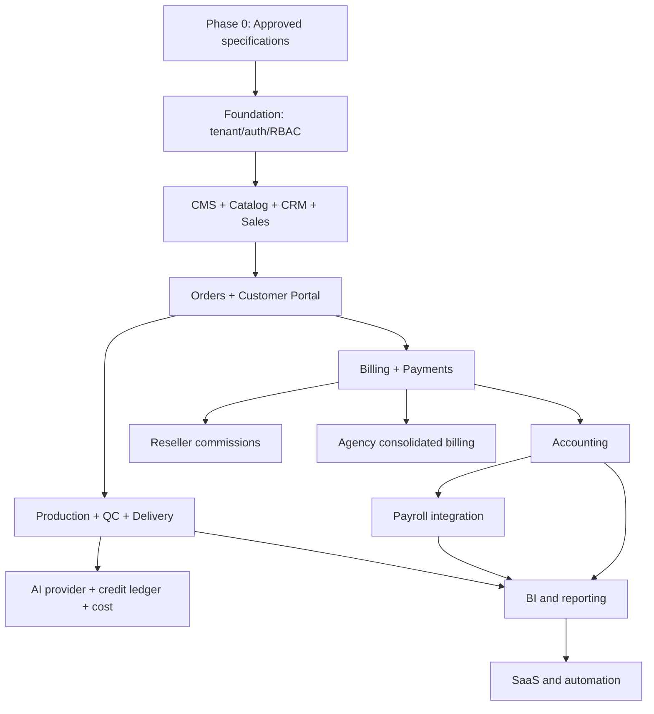

# 05 — GitHub Backlog, Phases and Dependencies

**Version:** 0.1 Draft | **Planning method:** epics → issues → acceptance criteria  
Priorities: `P0` blocking foundation, `P1` required for first usable release, `P2` expansion, `P3` later optimization.

## Phase 0 — Product and technical specification
| ID | Epic / issue | Priority | Depends on | Definition of done |
|---|---|---:|---|---|
| SPEC-01 | Approve product scope, assumptions and decision log | P0 | — | Owner signs scope and open decisions |
| SPEC-02 | Finalize SRS and acceptance criteria for 20 modules | P0 | SPEC-01 | Requirements reviewed and versioned |
| SPEC-03 | Normalize ERD and complete column dictionary | P0 | SPEC-02 | FK, indexes, constraints and tenant ownership reviewed |
| SPEC-04 | Approve RBAC permission and scope matrix | P0 | SPEC-02 | Role/action/scope matrix and negative tests approved |
| SPEC-05 | Approve portal/workspace IA and prototype | P0 | SPEC-02 | Key user flows validated |
| SPEC-06 | Select auth, ORM, storage, payment and deployment approach | P0 | SPEC-01 | ADRs recorded; no unverified integration assumed |
| SPEC-07 | Threat model, privacy, retention and backup plan | P0 | SPEC-03, SPEC-04 | Security review and recovery objectives approved |

## Phase 1 — Foundation
| ID | Epic / issue | Priority | Depends on | Definition of done |
|---|---|---:|---|---|
| FND-01 | Initialize app framework, TypeScript, lint, tests and CI | P0 | SPEC-06 | CI green on PR |
| FND-02 | Environment config and secret management | P0 | FND-01 | No secrets committed; startup validation works |
| FND-03 | Database schema/migration framework | P0 | SPEC-03, FND-01 | Empty DB migration replay succeeds |
| FND-04 | Tenant, organization, branch and settings schema | P0 | FND-03 | Tenant context and constraints tested |
| FND-05 | Authentication and session lifecycle | P0 | SPEC-06, FND-04 | Sign-in/out/recovery verified |
| FND-06 | RBAC policy engine and scoped query helpers | P0 | FND-04, SPEC-04, FND-05 | Positive and negative authorization suite passes |
| FND-07 | Audit log and privileged action middleware | P0 | FND-06 | Mutations create redacted audit events |
| FND-08 | App shell, navigation and design tokens | P1 | SPEC-05, FND-01 | Responsive shell and role-aware nav |
| FND-09 | CMS pages, revisions and publishing | P1 | FND-06, FND-08 | Draft/publish/preview works |
| FND-10 | Catalog, service versions and price lists | P1 | FND-03, FND-06 | Price/spec snapshot tests pass |
| FND-11 | CRM customers, leads and activities | P1 | FND-06, FND-08 | Scope-safe CRUD and timeline |
| FND-12 | Sales pipeline and quotation workflow | P1 | FND-10, FND-11 | Quote approval and conversion tested |
| FND-13 | Order and order-item snapshots | P1 | FND-10, FND-12 | Quote-to-order preserves snapshot |
| FND-14 | Customer portal skeleton and order visibility | P1 | FND-05, FND-06, FND-13 | Customer isolation tests pass |
| FND-15 | File upload/download authorization | P1 | SPEC-06, FND-06 | Private storage and signed URL tests |
| FND-16 | Foundation UAT, security and deployment preview | P0 | FND-09..FND-15 | UAT checklist signed; no production migration |

## Phase 2 — Creative production and AI operations
| ID | Epic / issue | Priority | Depends on | Definition of done |
|---|---|---:|---|---|
| OPS-01 | Creative briefs and production jobs | P1 | FND-13, FND-15 | Job lifecycle works |
| OPS-02 | Task assignment, schedule and capacity | P1 | OPS-01, FND-06 | Assignment scopes enforced |
| OPS-03 | Asset versioning, QC and revisions | P1 | OPS-01, FND-15 | Approval/revision lifecycle works |
| AI-01 | Provider/model registry | P1 | FND-04 | Provider capability and status managed |
| AI-02 | Credit account and append-only ledger | P0 | AI-01, SPEC-03 | Balance derives from ledger; no mutation/deletion |
| AI-03 | Generation job tracking and manual adapter | P1 | AI-01, AI-02, OPS-01 | Manual/provider job lifecycle reconciles |
| AI-04 | Credit cost allocation and provider reconciliation | P1 | AI-02, AI-03, FND-13 | Cost report reconciles to source records |
| OPS-04 | Customer review, delivery and closeout | P1 | OPS-03, FND-14 | Customer approves/downloads final asset |

## Phase 3 — Partners, projects and billing
| ID | Epic / issue | Priority | Depends on | Definition of done |
|---|---|---:|---|---|
| PART-01 | Reseller onboarding, tiers and price lists | P2 | FND-10, FND-11 | Reseller scope tests pass |
| PART-02 | Commission ledger and payout approvals | P2 | PART-01, BILL-02 | Accrual/reversal is reproducible |
| PART-03 | Agency workspace, client mapping and members | P2 | FND-06, FND-11 | Agency client isolation passes |
| PART-04 | Agency projects, wholesale and consolidated billing | P2 | PART-03, PROJ-01, BILL-01 | Client billing roll-up reconciles |
| PROJ-01 | Project, milestone, contract and change request | P2 | FND-13 | Versioned scope and approvals |
| BILL-01 | Invoice and billing schedules | P1 | FND-13 | Invoice snapshots and numbering |
| BILL-02 | Payments, allocation, receipt and webhook idempotency | P1 | BILL-01, SPEC-06 | Duplicate events do not duplicate money |
| BILL-03 | Credit notes, refunds and approval controls | P1 | BILL-02, FND-06 | Dual-control and reversal tests |

## Phase 4 — Procurement and accounting
| ID | Epic / issue | Priority | Depends on | Definition of done |
|---|---|---:|---|---|
| ERP-01 | Vendors, purchase requisition and PO | P2 | FND-06 | Approval workflow |
| ERP-02 | Goods receipt, inventory and stock ledger | P2 | ERP-01 | Stock balance reconciles to movements |
| FIN-01 | Chart of accounts and journal engine | P1 | SPEC-03 | Double-entry invariant tested |
| FIN-02 | AR/AP, cash/bank and reconciliation | P1 | BILL-02, FIN-01 | Subledger and GL reconcile |
| FIN-03 | Tax, fixed assets, budgets and period close | P2 | FIN-01, FIN-02 | Period close and reversal workflow |
| ERP-03 | Procurement/accounting integration | P2 | ERP-02, FIN-01 | PO/GR/vendor bill posting verified |

## Phase 5 — HR and payroll
| ID | Epic / issue | Priority | Depends on | Definition of done |
|---|---|---:|---|---|
| HR-01 | Employee, contract and compensation records | P2 | FND-06 | Field-level confidentiality tests |
| HR-02 | Attendance, shifts, leave and overtime | P2 | HR-01 | Accrual and approval rules tested |
| HR-03 | Payroll components and payroll run | P2 | HR-01, HR-02 | Gross/net calculation test suite |
| HR-04 | Payroll approval, payslip and GL export | P2 | HR-03, FIN-01 | Separation of duties and posting verified |

## Phase 6 — BI, automation and SaaS readiness
| ID | Epic / issue | Priority | Depends on | Definition of done |
|---|---|---:|---|---|
| BI-01 | Reporting catalog and governed queries | P2 | Relevant module data | Report totals reconcile |
| BI-02 | PDF/XLSX/CSV exports | P2 | BI-01, FND-06 | Scope and masking enforced |
| SaaS-01 | Tenant plan, quotas and entitlements | P2 | FND-04 | Feature gates enforce server-side |
| SaaS-02 | Tenant onboarding and provisioning | P3 | SaaS-01, FND-05 | Repeatable tenant setup |
| AUTO-01 | Notifications, reminders and workflow automation | P3 | FND-07, BI-01 | Idempotent, auditable jobs |
| OPS-05 | Observability, backup drills and incident runbooks | P0 | FND-16 | Restore and incident exercise documented |

## Dependency overview

## Definition of ready / done
- Ready: business owner, user story, permission scope, data entities, state transitions, acceptance tests, UX reference and dependencies are known.
- Done: code reviewed, tests pass, authorization tests pass, audit behavior verified, migrations reviewed, docs updated, preview smoke-tested, no unresolved critical security issue.
- No issue is considered complete because a screen exists; backend persistence, validation, authorization and tests are required.
